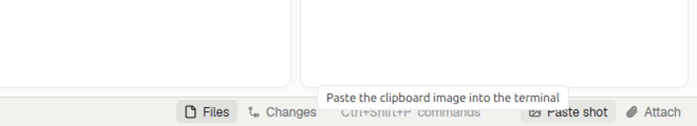

# Attach

Two small buttons for any layout: **Attach** picks files with the system file dialog and pastes their paths into the focused terminal, and **Paste shot** (shown only while the clipboard holds an image) saves that image as a PNG and pastes its path. Claude Code turns a pasted image path into an image attachment, so this is how you hand an agent a screenshot on Windows, where Herdr's Ctrl+V pastes only text.

This file is the brief: enough to build Attach from an empty folder. The files next to it are one build of it. If they don't work on your Herdr, or you want it different, build it again from here.

## What you see

- One block, meant for the right end of the status bar: 28px high, about 190px wide. The buttons sit at its right edge on the chrome background with a top border, so it reads as part of the bar.
- **Attach**: paperclip icon + "Attach", 22px high, muted text, hover background. Shown while a terminal has focus.
- **Paste shot**: image icon + "Paste shot", left of Attach, same style. Shown only while a terminal has focus and the clipboard holds an image.
- Tooltips: "Attach files: paste their paths into the terminal", "Paste the clipboard image into the terminal".

## How it behaves

- **Attach** opens the system file dialog (multi-select): PowerShell `OpenFileDialog` on Windows, `osascript choose file` on macOS, `zenity` (else `kdialog`) on Linux. Cancel does nothing.
- The chosen paths are quoted the way a file drop would be (bare when safe, `'…'` on Unix, `"…"` on Windows), joined with spaces, a trailing space added, and pasted into the focused terminal **without Enter**.
- A terminal on another machine (its space has a `machine`) gets copies first: `hc put <machine>/<terminal> <file> --json` for each file, and the landed paths are pasted instead.
- Pasting borrows the clipboard: the text is written, `pane.focus` + `terminal.paste` run, and 600ms later the old clipboard text goes back if nothing else replaced it.
- **Paste shot** saves the clipboard image to the temp folder as `herdr-shot-YYYYMMDD-HHMMSS.png` (PowerShell `Clipboard.GetImage` / `wl-paste --type image/png` / `xclip -t image/png -o` / `osascript … «class PNGf»`), pastes its path like Attach, then puts the image back on the clipboard. For about 2–4 seconds the clipboard holds the path text.
- No image on the clipboard when pressed: a warning toast "No image on the clipboard."
- Commands for keys: `k-attach.attach`, `k-attach.paste-shot` (through `nextCommand()`).
- No agent-status display.

## Built from

- **One mod**, `mods/k-attach/`: `main.js` (the block and its commands), `attach.js` (dialog, quoting, paste), `shot.js` (clipboard watcher, save, put back), `paperclip.svg`, `image.svg`, `mod.json` (`"place": "none"`).
- **Layout:** a block `{ "id": "attach", "type": "block", "content": { "mod": "k-attach" }, "size": { "px": 190 } }`, e.g. split the status bar into a row of `[status (weight 1), attach]`. The mod has to be in the layout to run: the clipboard watcher and the commands live in that block.
- **herdr:** `focused()`, `spaces()`, `window().platform`, `exec`, `hc`, `run("pane.focus")`, `run("terminal.paste")`, `notify`, `nextCommand`, `shared` / `setShared` (only the watcher's id, `k.clip.watcher`), `theme()`; `cx.read_from_clipboard` / `cx.write_to_clipboard`.
- **Clipboard watcher:** one long-running process at a time that waits until "clipboard has an image" changes, then prints 1 or 0 (Windows: a PowerShell loop over `Clipboard.ContainsImage()`; Unix: a `sh` loop over `wl-paste --list-types` / `xclip -t TARGETS` / `osascript clipboard info`). It gives up after 5 minutes and is restarted, staying inside exec's 10-minute limit. Only the newest watcher keeps going after a reload.
- **Programs it runs:** `powershell.exe`, `osascript`, `zenity` / `kdialog`, `xclip` / `wl-paste` / `wl-copy`, `sh`, and `hc put` for remote terminals. It reads and writes only the temp folder and the clipboard.

## Watch out

- Without `xclip` (X11) or `wl-paste` (Wayland) on Linux, Paste shot never shows; Attach still works.
- A locked Windows screen makes `ContainsImage()` throw: keep waiting instead of reporting "no image".
- Putting the PNG back overwrites anything copied during those few seconds.
- `terminal.paste` pastes into the focused pane, so focus the target terminal first (`pane.focus`).
- The layout package `vscode-layout` carries a copy of this mod; keep them the same.
