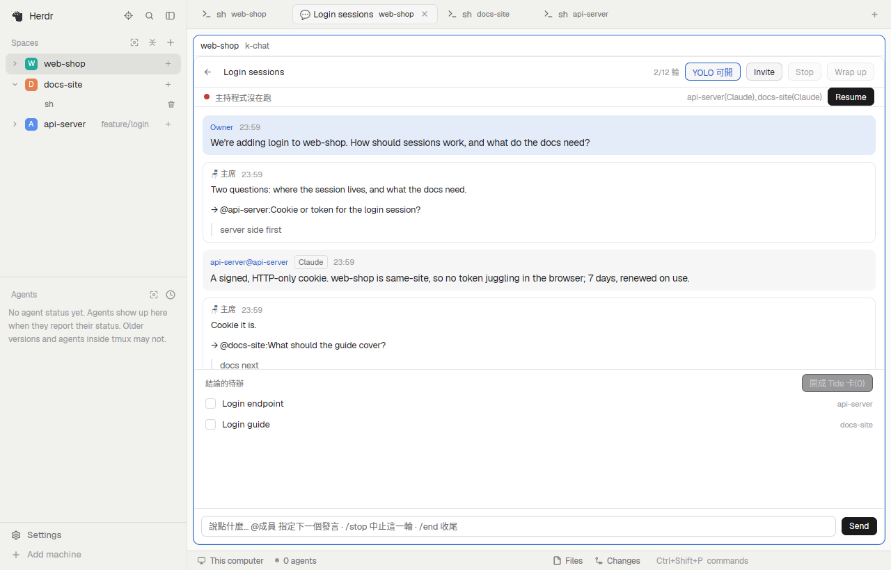

# Discussion

A group discussion among agents from several Spaces, chaired by an agent and hosted by you. You open with a question; each round the chair decides who speaks next (and may speak itself), each member answers from its own repo as a headless agent that keeps its own session, and at the end the chair writes a conclusion with to-dos. It also does plain one-to-one chats with one Space's agent. Every discussion is saved as Markdown in the main Space's repo (`doc/chat/<topic>.md`), so the conversation is kept.

This file is the brief: enough to build Discussion from an empty folder. The files next to it are one build of it. If they don't work on your Herdr, or you want it different, build it again from here.

## What you see

- **A list window** (`kind: "window"`, 780px wide, 86% high): "Discussions · <space>", one row per discussion (title, members with their model source, state and rounds), a "New discussion" button.
- **New discussion form:** topic and opening message, which Spaces to invite (other machines' too), each member's and the chair's source (Claude / Codex / Gemini, greyed out when that CLI isn't on this machine's PATH) and model name, a round limit, and whether the chair may grant YOLO.
- **The discussion view**, which is also the pane of a tab "💬 <title>" in the main Space: a header (back, title, rounds `n/max`, YOLO toggle, Invite, Stop, Wrap up), a host line (running or not, members, Resume), the record as cards: the Owner's messages in an accent-tinted card, the chair's turns (what it says, "→ @member: question", its reason as a quote), members' answers with a source badge, and finally the conclusion (Decided / Open / To do). Under it, the to-dos as checkboxes with their repo and a button to turn the checked ones into task cards. At the bottom an input ("say something… @member picks the next speaker · /stop · /end") and Send.
- **One-to-one chat:** the same view titled as a chat, no chair, with a "read only / may act" toggle in the header.
- In this build the UI labels are partly Traditional Chinese.

## How it behaves

- The chair (default `claude -p` with a JSON schema) answers each round with `{ say, next, ask, yolo, done, reason }`: optional words of its own, who speaks next and what to ask, whether that member may act this round, and whether it's done. It has no tools; what it can answer itself, it answers to the Owner directly.
- Members run headless in their own folders: `claude -p` (resuming their session), `codex exec`, or `agy`. By default they may only read, search and browse. When the chair grants YOLO for a round, the record gets a line `🔓 chair grants <member> YOLO: <reason>`, and it ends with that round.
- The Owner's message jumps the queue; `@member` makes that member speak next without the chair; `/stop` stops the current round; `/end` (Wrap up) asks the chair for the conclusion.
- One-to-one: no chair, you say a line and the agent answers; read-only until you switch "may act" on (a 🔓 line is recorded); inviting a second agent turns it into a chaired discussion.
- The turns are run by `tools/k-chat/runner.mjs` (Node 18+) in a background herdr-core terminal (`hc run --keep`, not in the sidebar), so closing the tab or the whole app doesn't stop a discussion; "Stop host" stops it, and saying something or Resume starts it again. The window only reads the files and writes to the runner's inbox (`doc/chat/<topic>.inbox/`).
- Files: the record `doc/chat/<topic>.md` (an H1 title, then `## <who> · <ISO time>` headings), the state `doc/chat/<topic>.json`.

## Built from

- **One mod**, `mods/k-chat/`: `main.js`, `mod.json` (`"place": "none"`, overlay `window` 780 × 0.86). Opened with `mod.open` (`{ name: "k-chat" }`, the shown Space is the main one) or with `props: { space }`; a discussion's tab is `tab.new { space, name: "💬 …", mod: "k-chat", props: { state, space } }`.
- **The runner**, `tools/k-chat/` (copied to `<App home>/tools/k-chat/`): `runner.mjs` (`new | list | start | run | say | invite | set | card | quit | sources | adopt`) and `lib.mjs` (record format, chair prompt and schema, turn logic). Also a Claude Code plugin (`.claude-plugin/`, `commands/`, `skills/`) so an agent can start and join discussions from its own session.
- **herdr:** `spaces()`, `exec` (node, the runner), `readTextFile`, `appHome()`, `run("tab.new")`, `notify`, `theme()`, `props()`, `closeOverlay`, `checking()`.
- **Programs it runs:** `node`, `claude`, `codex`, `agy`, `hc` (to host the runner and reach members on other machines), and optionally a `task` CLI for turning to-dos into cards.

## Watch out

- The main Space must be on this machine (the record is written there); members can be on other machines.
- Each member turn costs a real agent call; a round limit (default 12) keeps a discussion bounded.
- The runner is the only writer of state and record; anything else must go through the inbox, or two writers fight.
- The "open as cards" button needs a task-board CLI; without one, leave the to-dos as checkboxes.
- The vscode-layout package's Space menus add "Discussion" and "Chat" entries when this mod is installed.
