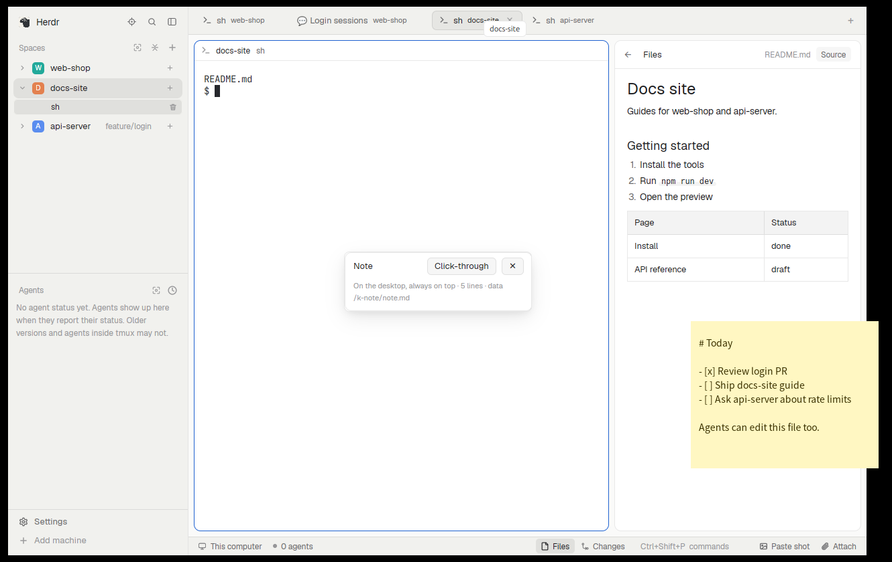

# Float

Desktop windows for mods. A mod's own overlays are drawn inside the Herdr window; Float opens real system windows that stay on top of every other program and stay visible when Herdr is minimized, showing HTML you give them. It comes with **Note**, a sticky note on the desktop whose text is a Markdown file that you and your agents can both edit.

This file is the brief: enough to build Float from an empty folder. The files next to it are one build of it. If they don't work on your Herdr, or you want it different, build it again from here.

## What you see

- **Note:** a borderless, always-on-top window (280 × 220, pale yellow `#fff7c2`, system UI font, 14px) holding the text of `<App home>/data/k-note/note.md`. It can be dragged and resized, and its place and size are remembered. In Herdr, a small window "Note" (280px wide) is its switch: a line "On the desktop, always on top · N lines · data/k-note/note.md", a **Click-through** toggle (the mouse goes through the note to whatever is behind) and ×.
- **Float demo** (`mod.open` with `{ name: "k-float" }`): a counter window that shows the round trip between a mod and its page.
- Anything else a mod or a script opens: whatever HTML it gives, framed or not, with an optional opacity, a hover opacity, and a "collapsed" state that folds the window into a small button.

## How it behaves

- **The SDK** (`float.js`, copied into each mod that uses it, since a mod imports only from its own folder):
  `float.open({ id, html, data, x, y, width, height, topmost, frame, clickThrough, opacity, hoverOpacity })`, `float.update(id, { data | html | … })`, `float.close(id)`, `float.collapse(id)` / `float.expand(id)`, and `float.listen(cx, id, (event, cx) => …)` for `ready`, `message`, `moved`, `closed` (`by: "user" | "spec"`), `pick`.
- **In the page:** `float.send(value)` reaches the mod as a `message`; `float.onData(fn)` receives `update(id, { data })` without reloading (typing isn't lost; changing `html` reloads); `data-float-drag` makes an element drag the window; `data-float-drag-click` does the same on a button (a 4px move drags, a release without moving clicks); `float.onCollapsed(fn)`.
- **The helper** (`tools/k-float`, Rust: `tao` + `wry`, the system webview) works from files, so an agent or a script can open windows without a mod: it watches `<App home>/data/k-float/windows/<id>.json` (a window per spec file; deleting the file closes it) and appends events to `events/<id>.jsonl`. One helper per App home; `start` launches it if needed, it exits after a while with no windows, and `stop` ends it. The file protocol is `doc/k-float-protocol.md` in this repo.
- **Note:** typing saves to `note.md`; when an agent or a script changes that file, the note follows. Closing either the Herdr switch or the note closes both.
- **Picking:** every window's page has a built-in element picker for agents. It turns on when the Pick package is open (a fresh flag file `data/k-float/pick`) or with Ctrl+F12 inside the window: an outline follows the pointer, a click copies `float=<id> | selector=… | tag=… | text=… | at=(x,y) in element … | window=W×H` and writes an event `{ type: "pick", locator }`. Esc leaves.

## Built from

- **Two mods**, `mods/k-float/` (`float.js`, the SDK; `main.js`, the demo) and `mods/k-note/` (`main.js` and its own copy of `float.js`); each `mod.json` has `"place": "none"` and a small `window` overlay (`key` set so it reopens where it was).
- **The helper**, `tools/k-float/` (Cargo project). Build it on each machine with `cargo build --release`; the SDK looks for `<App home>/tools/k-float/target/release/k-float` (`.exe` on Windows). Linux needs `libwebkit2gtk-4.1-dev` and `libgtk-3-dev` to build.
- **herdr:** `exec` (the helper's `start` / `stop`), `appHome()`, `watchFolder` (events), `window().platform`, `fs/promises` (spec files), `theme()`, `props()`, `closeOverlay`.
- **Programs it runs:** the helper only. It writes under `<App home>/data/k-float/` and, for Note, `data/k-note/note.md`.

## Watch out

- No Rust toolchain, no windows: the mods say the helper is missing.
- Windows can't replace a running `.exe`: stop the helper before rebuilding it.
- On Linux under X11 without a compositor, borderless transparency and click-through depend on the window manager; Xvfb draws the windows but some screen grabbers don't see them (`ffmpeg -f x11grab` does).
- Keep every copy of `float.js` identical to `mods/k-float/float.js`.
- Pages are your own HTML: treat `data` from agents as text, not markup.
