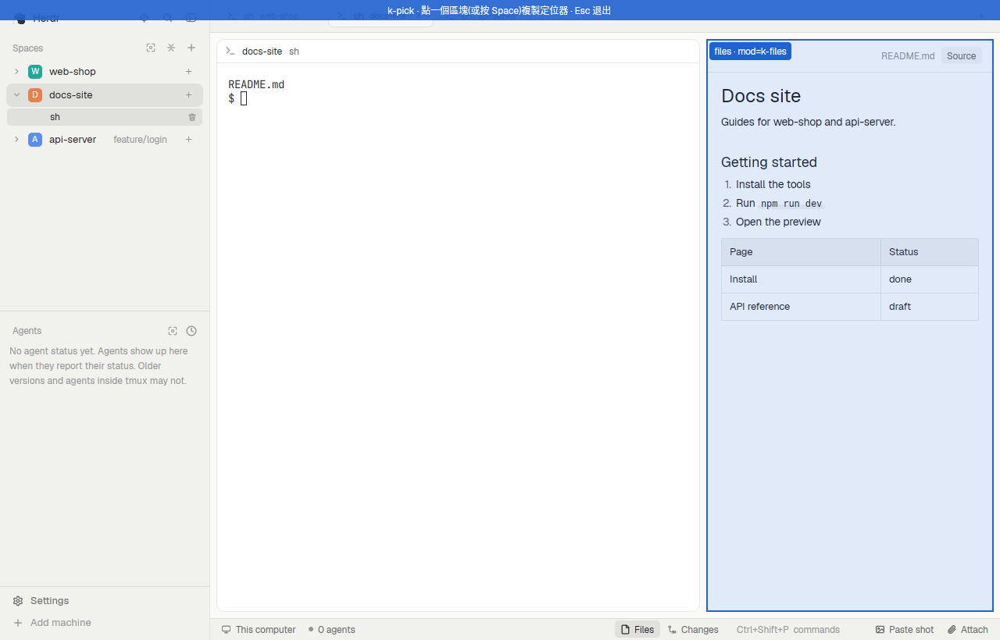

# Pick

Point at a part of the Herdr window for an agent, like DevPick on the web. A transparent layer covers the window and outlines the layout block under the pointer. A click copies a locator (layout, block, mod, its source file, the path through the layout tree, and the click position) plus a window screenshot with the spot marked, so you can paste "this, here" to an agent instead of describing it.

This file is the brief: enough to build Pick from an empty folder. The files next to it are one build of it. If they don't work on your Herdr, or you want it different, build it again from here.

## What you see

- A full-window overlay with no frame (`kind: "window"`, 0.9999 × 0.9999, at 0,0) that draws nothing of its own except:
  - a top banner in the accent color with the instructions (in this build, in Traditional Chinese: "click a block (or press Space) to copy its locator · Esc to leave");
  - a 2px accent outline around the block under the pointer, a light accent wash inside it, and a small accent label at its top left: `<block id> · mod=<mod>` (or `terminal panes (Herdr)` for the tab area).
- After a click: a toast with the locator, and the overlay closes.

## How it behaves

- Moving the pointer recomputes the block under it from `layout()`: rows and columns, `px` and `weight` sizes, hidden nodes, and the active child of stacks. Pane headers count as their own block.
- Click (or Space / Enter at the pointer) copies, for example:
  `layout=k-main | block=sidebar-footer | mod=k-chrome | file=mods/k-chrome/main.js | path=root > sidebar > sidebar-footer | at=(52,1430) in block (44,12) of 268×69 | shot=<App home>/.k-pick/pick-YYYYMMDD-HHMMSS.png`
- The shot is `herdr-app shot` of the whole window with the outline and a red click mark in it, saved under `<App home>/.k-pick/` (local time in the name).
- **Dialogs and popups** aren't in `layout()`: `herdr-app status` names the open ones, their `mod.json` gives the size (dialogs sit centered), and a pick inside one reports `overlay=… | kind=dialog | mod=…`. A mod can report its real size in shared `k-pick.sizes` (`{ <mod>: { width, height } }`). If the position can't be worked out, the locator says so and adds the block underneath.
- While a dialog is open, a click beside it closes the dialog first, so open Pick with its key (`ctrl-f12`) and pick with Space / Enter.
- **k-float windows** (desktop windows, see the k-float package): while Pick is open it keeps a flag file `<App home>/data/k-float/pick` fresh; each k-float window then picks inside its own page and reports `float=<id> | selector=… | tag=… | text=… | at=… | window=W×H` (text only). When one is picked, the helper writes `data/k-float/picked` and Pick closes.
- Esc leaves and clears the flag files.

## Built from

- **One mod**, `mods/k-pick/`: `main.js` and `mod.json` with `"place": "none"` and the overlay spec above.
- **A `keys.json` snippet**, merged into the person's keys: `{ "global": { "ctrl-f12": "mod.open:k-pick" } }`. Any other way to run `mod.open` with `{ name: "k-pick" }` works too (the vscode-layout package puts a crosshair button in its title bar when this mod is installed).
- **herdr:** `layout()`, `shared("k-pick.sizes")`, `props()`, `closeOverlay`, `openOverlay`, `exec`, `appHome()`, `readTextFile` (other mods' `mod.json`), `notify`, `window()`, `checking()`, `theme()`; `fs/promises` for the k-float flag files; `cx.write_to_clipboard`.
- **Programs it runs:** `herdr-app status` and `herdr-app shot`, `mkdir -p` (or PowerShell `New-Item` on Windows) for the shot folder.

## Watch out

- It reads other mods' `mod.json` files in the App home and writes `.k-pick/` and `data/k-float/` there.
- The block math must match Herdr's own layout rules (px first, weights share the rest, hidden nodes take no space, stacks show one child); a new layout feature can make outlines drift.
- The banner text is Chinese in this build; translate it if you like.
- Without the k-float package the flag files are harmless and nothing reads them.
