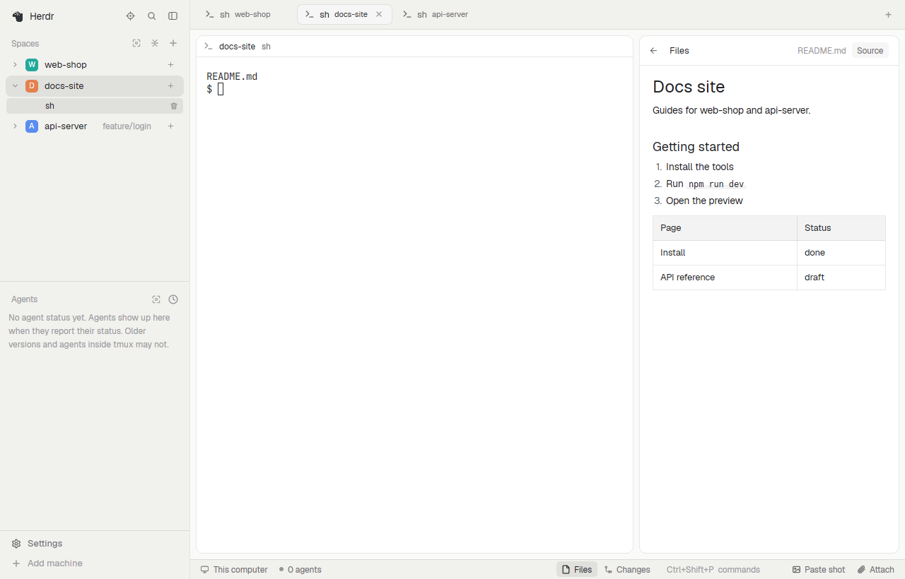

# VS Code-style workbench

Herdr's main window reworked to feel like VS Code: a tab bar of the sessions you opened (across spaces and machines, like editor tabs), a Spaces tree that folds out each space's tabs like the file explorer, pane headers that show which model and effort an agent runs (click to switch), Markdown previews in the Files panel, Eclipse/IntelliJ-style navigation keys, and a Settings window with Keys, Profiles and Mods pages. It is the `main` layout with its shipped blocks swapped for edited clones (`k-` prefix), plus the Attach block.

This file is the brief: enough to build the workbench from an empty folder. The files next to it are one build of it. If they don't work on your Herdr, or you want it different, build it again from here.

## What you see

Left to right, top to bottom (`layouts/k-main.json`):

- **Sidebar** (268px column): the title bar (46px, `k-chrome`: Herdr logo and name, a crosshair button for Pick when that package is installed, search, collapse), **Spaces** and **Agents** lists sharing the height (`k-spaces`, `k-agents`), and a 69px footer (`k-chrome` with `props: { footer }`: Settings, Add machine).
- **Work area:** the tab bar (42px, `k-tabs`), then a row of the terminal pane (headers by `k-pane`) and a 368px side panel stack (`k-files`, shipped `changes`), then the status bar (28px), split into `k-status` and `k-attach` (190px).
- **Tabs:** each tab shows the program icon, its name and, when the bar holds tabs from more than one space, the space name in small text in the same color. × shows on the shown tab and on hover (each tab keeps its place, so nothing jumps). One line that scrolls, or several lines (Settings → Look → "Tabs on several lines").
- **Spaces:** a row per space with a colored initial, its name, its git branch, a fold arrow and a count of folded tabs, and "+" on hover. Folded out, its tabs are listed under it with a trash icon. The header has Select Opened, Collapse All, a hidden-count eye and "+".
- **Agents:** grouped by status (Needs you, Working, Done, Idle) with sub-agents under their parent. Each row's icon is the **model's** (Opus gem, Sonnet feather, Haiku leaf, Fable book; Codex brackets, mini bolt, other GPT star), backed by the **effort**: none for low, light for medium, stronger for high, a ring for xhigh / max. The header has Select Opened.
- **Pane header:** the model icon on its effort tint (or the program icon), the machine (other machines only), the space name, the terminal's own name, chips other mods add (`shared("k-pane.chips")`), the status (spinner, "Needs you", done dot), and split / zoom / close on hover. The folder path is in the tooltip, not written out.
- **Status bar:** machine, branch, agent count and "N need you" on the left; Files and Changes (open the side panel, remembered per space) and the palette key on the right; then the Attach block.
- **Files panel:** `.md` files rendered (headings, lists, tables, code, links) with Source / Preview at the top right.

## How it behaves

- **Tabs are the sessions you opened**, not the shown space's: viewing a tab adds it to the bar (right of the previous one); switching spaces keeps them. A click jumps to it (across spaces and machines); the wheel cycles; dragging reorders only the bar. × (or a middle click) puts the tab away (`tab.settle`): the program keeps running and the sidebar brings it back. Closing the shown tab shows its right (else left) neighbour; the last tab has no ×. Right-click: Close, Close Other Tabs, Close All Tabs (the shown one stays), Rename, New tab, and **End tab** (`tab.close`, which stops the program). The list is kept per profile.
- **Spaces:** a click selects a space and folds its tabs in or out; a click on a tab row brings it back; trash, or Del on the selected row, really closes it. "+" on a space: Terminal, Chat (when the Discussion package is installed), or an agent from `knownAgents()` with a remembered YOLO switch (Y). For Claude Code, Codex and Antigravity it first lists that folder's earlier sessions (newest 12, headless runs left out) to resume, with New at the bottom (`claude --resume`, `codex resume`, `agy --conversation`). "+" on a machine (also the header's "+"): its GitHub repos (cloned on first open), the repo folder (Choose), and **Open a folder…** (the system folder dialog here; a folder browser for another machine). Right-click: a space (Rename, worktrees, Copy name / path, MCP & Skills, Discussion, Hide, Close), a tab row (Copy path / address, Rename, New tab, Close), a machine (Agents: installed agents with running and today's counts, MCP servers, skills, plugins; Hide). Hidden spaces and machines are per window. **Select Opened** unfolds and shows the space of the shown session; **Collapse All** folds every space's tab list.
- **Agents:** right-click → Copy address (`back/t8` style for `hc send`). Other mods can name a row or add a tag with `setShared("k-agents.rows", { "<address>": { name, tag, color, by } })`.
- **Model and effort:** Claude Code reports them through a statusLine script (`tools/statusline/herdr-statusline.sh` writes the terminal labels `herdr.model` / `herdr.effort`); Codex's come from its command line (`-m`, `-c model_reasoning_effort=`). **Clicking the model icon** in a pane header opens a menu: for Claude Code Fable / Opus / Sonnet / Haiku and Effort low…max (current ones checked), typed in as `/model <alias>` or `/effort <level>` with `hc send`; for Codex one item that types `/model` to open Codex's own picker. Claude Code also saves the choice as the default for new sessions.
- **Navigation keys** (Eclipse): `alt-left` / `alt-right` go back / forward through the panes you viewed (like a browser, 50 entries, closed ones skipped), `ctrl-q` goes to where you last sent input (the agent that last started working). `ctrl-shift-t` opens the shipped Go-to picker (type to filter tabs, spaces and agents; arrows; Enter).
- **Settings** (`k-settings`, opened from the footer): the app's settings plus **Keys** (every binding by section, searchable, press-to-record, conflicts asked, Add shortcut, saved to `keys.json`), **Profiles** (more windows, each its own App home `~/.config/herdr-app-<name>` sharing one core, with a start-menu / `.desktop` entry), and **Mods** (installed mods with source and updates; a Marketplace of GitHub repos with the `herdr-mod` topic, with a review of what a mod runs, reaches and binds before installing; disable / enable).
- The status bar's Attach / Paste shot: see the Attach package (`mods/k-attach/` here is a copy of it).

## Built from

- **Layout** `layouts/k-main.json`: the shipped `main` with `tabs` → `k-tabs`, `spaces` → `k-spaces`, `agents` → `k-agents`, `workspace-chrome` → `k-chrome` (twice), `files` → `k-files`, pane headers `pane` → `k-pane`, `workspace-status` → `k-status`, and the status block replaced by a row `[k-status (weight 1), k-attach (190px)]`.
- **Mods** (each `mod.json` has `"place": "none"`; some record the shipped mod they were cloned from in `cloned_from`): `k-tabs` (`open.js` tab-list logic, `menu.js` right-click menu), `k-spaces` (`agents.js` the "+" menu, `sessions.js` session lists, `repos.js` the machine menu, `menu.js` right-click menus, `inspect.js` Agents / MCP & Skills, `has.js`), `k-agents` (`model.js`, `m-*.svg`), `k-chrome` (`nav.js` history, `has.js`), `k-pane` (`core.js` chips and model menu, `switch.js` the menu, its own copy of `model.js` and icons), `k-status`, `k-files`, `k-settings` (`keys.js`, `profiles.js`, `mods.js`, `core.js`; the Mods page is derived from jacksonpires/herdr-app-mod-manager, MIT), `k-attach`.
- **`keys.json` snippet**, merged: `alt-left` → `k-chrome.back`, `alt-right` → `k-chrome.forward`, `ctrl-q` → `k-chrome.last-input`, `ctrl-shift-t` → `mod.open:picker` (only where those keys are free or still Herdr's defaults; ask before replacing a key the person uses).
- **`tools/statusline/herdr-statusline.sh`:** Claude Code's `statusLine` command in `~/.claude/settings.json` (only if none is set) so agents report model and effort.
- **herdr:** `spaces`, `agents`, `panes`, `terminals`, `focused`, `layout`, `run` (tab.*, space.*, pane.*, layout.*), `openOverlay` / `closeOverlay`, `shared` / `setShared`, `knownAgents`, `exec`, `hc`, `readTextFile` / `writeTextFile`, `appHome`, `keys`, `settings`, `nextCommand`, `notify`, `theme`, `window`, `setAgentOrder`.
- **Programs it runs:** `hc` (send, machine list, put), `git` and `gh` (repos, clone, Mods marketplace), `sh` / PowerShell (read session lists, MCP and skills config, folder dialogs `zenity` / `kdialog` / `osascript` / PowerShell), `node` on the agent's machine for Codex / Antigravity session lists (Node 23.4+ for Antigravity's SQLite).

## Watch out

- Shipped mods and layouts are overwritten at every start: keep the clones under new names (`k-` here) and point the layout at them.
- Two mods can't import each other: shared code is copied (`model.js` and icons in `k-agents` and `k-pane`, `k-attach` here and in its own package) and must be kept equal.
- A copy of a mod in a popup (menus) can't reach the bar's instance: they talk through `shared` keys (`k-tabs.do`).
- The tab bar's list, folded spaces and hidden items are per profile (`localStorage` / `shared.json` of that App home).
- Windows: changes through a symlinked mod folder don't hot-reload; switch layouts to reload.
- Entries for the Discussion and Pick packages show only when those mods are in the App home.
